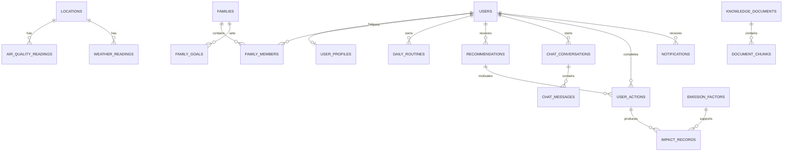

# AirWise AI — Database Design

**Version:** 1.0  
**Database:** PostgreSQL  
**Vector search:** pgvector  
**Scope:** India-wide, individual accounts with optional family groups

## 1. Design principles

- Use UUID primary keys for application entities.
- Store timestamps in UTC (`TIMESTAMPTZ`); convert to the user's local time in the frontend.
- Keep raw provider readings and normalized readings traceable to their source.
- Store source metadata and calculation assumptions for all environmental impact estimates.
- Separate measured values from estimated values.
- Family membership is optional. A user can use AirWise AI without joining a family.
- Enforce access control in the backend; hiding a frontend component is not authorization.

## 2. Main entity relationship diagram

## 3. Tables and columns

### 3.1 `users`

Stores login identity and account status.

| Column | Type | Constraints / purpose |
|---|---|---|
| `user_id` | UUID | PK |
| `full_name` | VARCHAR(120) | NOT NULL |
| `email` | VARCHAR(255) | UNIQUE, NOT NULL |
| `password_hash` | TEXT | NOT NULL; never store plaintext |
| `account_status` | VARCHAR(20) | e.g. active, disabled |
| `email_verified_at` | TIMESTAMPTZ | Nullable |
| `created_at` | TIMESTAMPTZ | NOT NULL |
| `updated_at` | TIMESTAMPTZ | NOT NULL |

### 3.2 `user_profiles`

One optional profile per user. Keep sensitive profile details to the minimum needed for recommendations.

| Column | Type | Constraints / purpose |
|---|---|---|
| `profile_id` | UUID | PK |
| `user_id` | UUID | FK → users.user_id, UNIQUE |
| `phone_number` | VARCHAR(20) | Optional |
| `location_id` | UUID | FK → locations.location_id |
| `latitude` | NUMERIC(9,6) | Optional; use only with consent |
| `longitude` | NUMERIC(9,6) | Optional; use only with consent |
| `household_size` | SMALLINT | Optional |
| `primary_transport_mode` | VARCHAR(40) | e.g. petrol_bike, car, bus, metro, walk |
| `daily_commute_km` | NUMERIC(8,2) | Optional |
| `sustainability_goal` | VARCHAR(80) | Optional |
| `created_at` | TIMESTAMPTZ | NOT NULL |
| `updated_at` | TIMESTAMPTZ | NOT NULL |

### 3.3 `locations`

Canonical Indian location catalogue and user-selected locations.

| Column | Type | Constraints / purpose |
|---|---|---|
| `location_id` | UUID | PK |
| `country_code` | CHAR(2) | Default IN |
| `state_name` | VARCHAR(100) | Nullable for broad locations |
| `district_name` | VARCHAR(100) | Optional |
| `city_name` | VARCHAR(120) | NOT NULL |
| `area_name` | VARCHAR(150) | Optional |
| `latitude` | NUMERIC(9,6) | Optional |
| `longitude` | NUMERIC(9,6) | Optional |
| `created_at` | TIMESTAMPTZ | NOT NULL |

### 3.4 `families`

| Column | Type | Constraints / purpose |
|---|---|---|
| `family_id` | UUID | PK |
| `family_name` | VARCHAR(120) | NOT NULL |
| `created_by` | UUID | FK → users.user_id |
| `invite_code_hash` | TEXT | Store a hash, not a reusable plain invitation secret |
| `created_at` | TIMESTAMPTZ | NOT NULL |

### 3.5 `family_members`

| Column | Type | Constraints / purpose |
|---|---|---|
| `membership_id` | UUID | PK |
| `family_id` | UUID | FK → families.family_id |
| `user_id` | UUID | FK → users.user_id |
| `role` | VARCHAR(20) | owner, admin, member |
| `joined_at` | TIMESTAMPTZ | NOT NULL |

**Constraints:** UNIQUE (`family_id`, `user_id`). Add backend rules for invitation expiry, membership limits and role permissions. A user may belong to more than one family only if that is allowed by product policy.

### 3.6 `air_quality_readings`

Stores normalized observations from providers. Do not assume all providers report every pollutant.

| Column | Type | Constraints / purpose |
|---|---|---|
| `reading_id` | UUID | PK |
| `location_id` | UUID | FK → locations.location_id |
| `provider` | VARCHAR(60) | e.g. CPCB, OpenAQ |
| `station_id` | VARCHAR(120) | Provider station identifier |
| `aqi_value` | NUMERIC(8,2) | Nullable |
| `aqi_standard` | VARCHAR(40) | e.g. CPCB_India, US_AQI |
| `aqi_category` | VARCHAR(30) | Nullable |
| `pm25_value` | NUMERIC(10,3) | Nullable |
| `pm10_value` | NUMERIC(10,3) | Nullable |
| `no2_value` | NUMERIC(10,3) | Nullable |
| `so2_value` | NUMERIC(10,3) | Nullable |
| `co_value` | NUMERIC(10,3) | Nullable |
| `o3_value` | NUMERIC(10,3) | Nullable |
| `nh3_value` | NUMERIC(10,3) | Nullable |
| `pb_value` | NUMERIC(10,3) | Nullable |
| `unit_metadata` | JSONB | Units per pollutant |
| `observed_at` | TIMESTAMPTZ | Provider observation time |
| `fetched_at` | TIMESTAMPTZ | Time AirWise retrieved it |
| `quality_status` | VARCHAR(30) | valid, partial, stale, invalid |
| `source_url` | TEXT | Optional provider reference |

**Important:** Retain the AQI standard. Do not compare or relabel AQI values from different national standards as if they were equivalent. Calculate CPCB National AQI only when the required pollutant data and official methodology are available.

### 3.7 `weather_readings`

| Column | Type | Constraints / purpose |
|---|---|---|
| `weather_reading_id` | UUID | PK |
| `location_id` | UUID | FK → locations.location_id |
| `provider` | VARCHAR(60) | NOT NULL |
| `temperature_c` | NUMERIC(6,2) | Nullable |
| `relative_humidity` | NUMERIC(6,2) | Nullable |
| `wind_speed` | NUMERIC(8,2) | Nullable |
| `wind_direction` | NUMERIC(6,2) | Nullable |
| `precipitation_mm` | NUMERIC(8,2) | Nullable |
| `observed_at` | TIMESTAMPTZ | NOT NULL |
| `fetched_at` | TIMESTAMPTZ | NOT NULL |

### 3.8 `daily_routines`

| Column | Type | Constraints / purpose |
|---|---|---|
| `routine_id` | UUID | PK |
| `user_id` | UUID | FK → users.user_id |
| `title` | VARCHAR(160) | NOT NULL |
| `description` | TEXT | Optional |
| `routine_date` | DATE | NOT NULL |
| `start_time` | TIME | Optional |
| `end_time` | TIME | Optional |
| `category` | VARCHAR(40) | travel, indoor_air, energy, waste, other |
| `status` | VARCHAR(20) | planned, completed, skipped |
| `created_at` | TIMESTAMPTZ | NOT NULL |

### 3.9 `recommendations`

| Column | Type | Constraints / purpose |
|---|---|---|
| `recommendation_id` | UUID | PK |
| `user_id` | UUID | FK → users.user_id |
| `title` | VARCHAR(180) | NOT NULL |
| `description` | TEXT | NOT NULL |
| `category` | VARCHAR(40) | NOT NULL |
| `priority` | VARCHAR(20) | low, medium, high |
| `reason` | TEXT | Explain why suggested |
| `context_snapshot` | JSONB | AQI/profile context used |
| `source_references` | JSONB | Document IDs, URLs and page references |
| `valid_from` | TIMESTAMPTZ | NOT NULL |
| `expires_at` | TIMESTAMPTZ | Optional |
| `created_at` | TIMESTAMPTZ | NOT NULL |

### 3.10 `user_actions`

| Column | Type | Constraints / purpose |
|---|---|---|
| `action_id` | UUID | PK |
| `user_id` | UUID | FK → users.user_id |
| `recommendation_id` | UUID | FK → recommendations.recommendation_id, nullable |
| `action_type` | VARCHAR(60) | e.g. public_transport, carpool |
| `details` | JSONB | Distance, mode, occupancy, etc. |
| `action_date` | DATE | NOT NULL |
| `status` | VARCHAR(20) | completed, cancelled |
| `created_at` | TIMESTAMPTZ | NOT NULL |

### 3.11 `emission_factors`

| Column | Type | Constraints / purpose |
|---|---|---|
| `factor_id` | UUID | PK |
| `activity_type` | VARCHAR(60) | transport, electricity, waste |
| `mode_or_fuel` | VARCHAR(60) | e.g. petrol_car, diesel_bus |
| `factor_value` | NUMERIC(14,6) | NOT NULL |
| `factor_unit` | VARCHAR(60) | e.g. kgCO2e/km |
| `geography` | VARCHAR(80) | India or applicable region |
| `source_name` | VARCHAR(160) | NOT NULL |
| `source_url` | TEXT | NOT NULL |
| `valid_from` | DATE | NOT NULL |
| `valid_to` | DATE | Nullable |
| `assumptions` | JSONB | Occupancy, boundaries, etc. |

### 3.12 `impact_records`

| Column | Type | Constraints / purpose |
|---|---|---|
| `impact_id` | UUID | PK |
| `user_id` | UUID | FK → users.user_id |
| `action_id` | UUID | FK → user_actions.action_id |
| `metric_type` | VARCHAR(40) | CO2e, fuel, electricity, waste |
| `baseline_value` | NUMERIC(14,4) | NOT NULL |
| `alternative_value` | NUMERIC(14,4) | NOT NULL |
| `saving_value` | NUMERIC(14,4) | NOT NULL |
| `unit` | VARCHAR(30) | NOT NULL |
| `method_version` | VARCHAR(40) | NOT NULL |
| `factor_snapshot` | JSONB | Factor and assumptions used |
| `evidence_type` | VARCHAR(20) | estimated, measured |
| `calculated_at` | TIMESTAMPTZ | NOT NULL |

### 3.13 RAG knowledge tables

#### `knowledge_documents`

- `document_id` UUID PK
- `title` VARCHAR
- `publisher` VARCHAR
- `source_url` TEXT
- `document_type` VARCHAR
- `topic` VARCHAR
- `geography` VARCHAR
- `published_at` DATE
- `version_label` VARCHAR
- `retrieved_at` TIMESTAMPTZ
- `content_hash` VARCHAR
- `review_status` VARCHAR

#### `document_chunks`

- `chunk_id` UUID PK
- `document_id` UUID FK → knowledge_documents.document_id
- `chunk_index` INTEGER
- `page_number` INTEGER
- `chunk_text` TEXT
- `embedding` VECTOR (dimension set to match the chosen embedding model)
- `metadata` JSONB

Use pgvector indexes appropriate to the embedding dimension and retrieval workload. Store embedding model name/version so vectors can be re-created when the model changes.

### 3.14 Chat tables

#### `chat_conversations`

- `conversation_id` UUID PK
- `user_id` UUID FK → users.user_id
- `title` VARCHAR
- `created_at` TIMESTAMPTZ
- `updated_at` TIMESTAMPTZ

#### `chat_messages`

- `message_id` UUID PK
- `conversation_id` UUID FK → chat_conversations.conversation_id
- `role` VARCHAR (user, assistant, system)
- `message_text` TEXT
- `source_references` JSONB
- `created_at` TIMESTAMPTZ

### 3.15 Optional supporting tables

- `family_goals`: shared family challenges and targets.
- `notifications`: user notification records and read status.
- `api_sync_logs`: provider sync status, errors and timestamps.
- `document_ingestion_jobs`: RAG ingestion status and failure details.
- `user_consents`: records consent for location, analytics and family sharing.

## 4. Relationship summary

| Parent | Child | Relationship |
|---|---|---|
| Users | User Profiles | One-to-one |
| Users | Family Members | One-to-many |
| Families | Family Members | One-to-many |
| Locations | Air Quality Readings | One-to-many |
| Locations | Weather Readings | One-to-many |
| Users | Recommendations | One-to-many |
| Users | Daily Routines | One-to-many |
| Users | User Actions | One-to-many |
| User Actions | Impact Records | One-to-many |
| Knowledge Documents | Document Chunks | One-to-many |
| Chat Conversations | Chat Messages | One-to-many |

## 5. Indexes and constraints

Recommended indexes:

- Unique index on `users.email`.
- Index on `air_quality_readings(location_id, observed_at DESC)`.
- Index on `weather_readings(location_id, observed_at DESC)`.
- Index on `daily_routines(user_id, routine_date)`.
- Index on `recommendations(user_id, created_at DESC)`.
- Index on `user_actions(user_id, action_date)`.
- Vector index on `document_chunks.embedding`.
- GIN indexes on JSONB fields only where query patterns justify them.

Use database constraints for valid statuses, non-negative distances and values, and foreign-key integrity. Validate provider data before inserting it.

## 6. Family data access rules

- Users can read and update their own profile.
- Family members can see only explicitly shared family information.
- Family owners/admins can manage invitations and membership according to role.
- A family member's personal chat history remains private by default.
- A user's individual impact data is not automatically shared unless the user opts in.
- Every family API must verify membership on the backend.

## 7. Important modelling decisions

- Do not store an AI-generated CO2 estimate as a measured fact.
- Keep emission factor source, unit, date and assumptions.
- Keep pollutant units and AQI standard alongside readings.
- Keep missing measurements as NULL, not zero.
- Keep source timestamps separate from retrieval timestamps.
- Consider data retention and deletion policies before collecting precise location history.
