# AirWise AI — Page Workflows

This document defines what each page displays, which buttons it contains, what each action does and which backend APIs it calls.

## 1. Common interaction rules

- All protected pages require an authenticated user.
- Show loading, success, error and empty states.
- Disable submit buttons while requests are in progress.
- Validate form fields before submitting.
- Display API errors in user-friendly language.
- Backend authorization is mandatory for every private resource.
- Display source and timestamp for environmental data.
- Never display an estimated environmental impact as measured.

## 2. Authentication pages

### 2.1 Registration

**Displayed data**
- Full name, email, password and confirm password fields.
- Terms/privacy consent.

**Buttons**
- `Create Account`: validates form and calls `POST /api/v1/auth/register`.
- `Already have an account? Login`: opens login page.

**Success**
- Show confirmation and proceed to login or verification flow, depending on backend configuration.

### 2.2 Login

**Displayed data**
- Email and password.
- Password visibility toggle.

**Buttons**
- `Login`: calls `POST /api/v1/auth/login`.
- `Forgot Password`: starts password recovery.
- `Create Account`: opens registration.

**Success**
- Store authentication tokens securely using the chosen web authentication strategy.
- Navigate to onboarding if profile setup is incomplete; otherwise Dashboard.

## 3. Onboarding page

**Displayed data**
- User name.
- City/state selector.
- Optional location permission.
- Household size.
- Transport mode.
- Daily travel distance.
- Sustainability goal.
- Optional family group choice.

**Buttons**
- `Use My Location`: requests browser permission; if accepted, reverse-geocodes coordinates.
- `Search Location`: searches supported Indian cities/areas.
- `Next`: validates current step and moves forward.
- `Back`: returns to previous step.
- `Skip`: skips optional fields.
- `Finish Setup`: calls profile update endpoint.

**API interactions**
- `GET /api/v1/locations/search?q=...`
- `POST /api/v1/users/profile` or `PUT /api/v1/users/me`

## 4. Dashboard page

### Displayed data

1. Greeting and selected location.
2. AQI value, category, standard, provider and observation time.
3. Available pollutant readings.
4. Weather summary.
5. Today's recommendations.
6. Planner events due today.
7. Weekly impact summary.
8. Pollution trend chart where history exists.

### Buttons and actions

| Button | Action |
|---|---|
| Change Location | Opens location selector |
| Refresh | Requests latest available environmental data |
| View Details | Opens air-quality details |
| Ask AI | Opens AI Assistant |
| View All Recommendations | Opens Recommendations page |
| Add to Planner | Opens event form prefilled from a recommendation |
| Mark Complete | Records action completion |
| View Impact | Opens Impact Tracker |

### API calls

- `GET /api/v1/air-quality/current?location_id=...`
- `GET /api/v1/weather/current?location_id=...`
- `GET /api/v1/recommendations/today`
- `GET /api/v1/routines?date=YYYY-MM-DD`
- `GET /api/v1/impact/summary?period=week`

## 5. Daily Planner page

### Displayed data

- Month/week/day calendar on larger screens.
- Agenda/list view on mobile.
- Selected date.
- Scheduled events.
- Event category and status.
- Reminder information.

### Buttons and actions

| Button | Action |
|---|---|
| Previous | Move calendar period backward |
| Next | Move calendar period forward |
| Today | Return to current date |
| Add Event | Open Add Event modal |
| Edit | Open event form with saved values |
| Delete | Confirm and delete event |
| Mark Complete | Change event status to completed |
| Filter | Filter by event category |
| Save | Validate and create/update event |
| Cancel | Close form without saving |

### Add Event form fields

- Title (required).
- Date (required).
- Start time.
- End time.
- Category (required).
- Description.
- Reminder preference.

### API calls

- `GET /api/v1/routines?from=...&to=...`
- `POST /api/v1/routines`
- `PUT /api/v1/routines/{routine_id}`
- `DELETE /api/v1/routines/{routine_id}`
- `PATCH /api/v1/routines/{routine_id}/status`

## 6. AI Assistant page

### Displayed data

- Conversation messages.
- Suggested questions.
- Input composer.
- Source references.
- Environmental context timestamp.
- Estimated-impact explanation where relevant.

### Buttons and actions

| Button | Action |
|---|---|
| Send | Submit message to assistant |
| New Chat | Create a conversation |
| Conversation History | Load prior conversation |
| Suggested Prompt | Fill or submit suggested question |
| Add to Planner | Create a planner event from a suitable recommendation |
| Copy | Copy answer text |
| View Source | Open source reference |
| Feedback | Submit helpful/not helpful feedback |

### API calls

- `POST /api/v1/assistant/chat`
- `GET /api/v1/assistant/conversations`
- `GET /api/v1/assistant/conversations/{id}`
- `POST /api/v1/assistant/feedback`

Example request:

```json
{
  "conversation_id": null,
  "message": "How can I reduce emissions from my daily commute?",
  "include_user_context": true
}
```

The backend retrieves the user's authorized context, current available environmental data and relevant RAG passages before invoking the LLM.

## 7. Recommendations page

### Displayed data

- Recommendation title and description.
- Category.
- Priority.
- Reason.
- Expected benefit.
- Source references.
- Validity or expiry.

### Buttons and actions

- `Mark Done`: records the associated action.
- `Add to Planner`: creates a routine event.
- `Save`: bookmarks the recommendation if bookmarking is implemented.
- `Dismiss`: hides the recommendation from the active list.
- `Filter`: filters category and priority.
- `View Source`: opens the cited document/source.

### API calls

- `GET /api/v1/recommendations`
- `POST /api/v1/activities`
- `POST /api/v1/routines`
- `PATCH /api/v1/recommendations/{id}/dismiss`

## 8. Impact Tracker page

### Displayed data

- Date range.
- Estimated CO2e avoided.
- Fuel, electricity or waste metrics where recorded.
- Trend chart.
- Activity breakdown.
- Methodology and emission-factor source.
- Estimated/measured status.

### Buttons and actions

- `Today`, `7 Days`, `30 Days`, `Custom Range`: changes reporting period.
- `View Calculation`: shows formula and assumptions.
- `View Activity`: opens source action.
- `Export`: downloads a report if export is implemented.

### API calls

- `GET /api/v1/impact/summary?from=...&to=...`
- `GET /api/v1/impact/records?from=...&to=...`
- `GET /api/v1/impact/records/{id}`

## 9. Family page

### Displayed data

- Family name.
- Member list and roles.
- Shared goals.
- Shared activities explicitly opted in.
- Family progress.

### Buttons and actions

| Button | Action |
|---|---|
| Create Family | Creates a family group |
| Invite Member | Generates an invitation |
| Join Family | Redeems invitation |
| Change Role | Updates member role if authorized |
| Remove Member | Removes membership if authorized |
| Create Goal | Creates shared sustainability goal |
| View Progress | Opens family impact view |
| Leave Family | Leaves group after confirmation |

### API calls

- `POST /api/v1/families`
- `GET /api/v1/families`
- `GET /api/v1/families/{id}`
- `POST /api/v1/families/{id}/invitations`
- `POST /api/v1/families/join`
- `DELETE /api/v1/families/{id}/members/{user_id}`
- `POST /api/v1/families/{id}/goals`

## 10. Profile and Settings page

### Displayed data

- Name and email.
- Location preferences.
- Lifestyle preferences.
- Sustainability goals.
- Notification settings.
- Privacy/consent settings.
- Family memberships.

### Buttons and actions

- `Edit Profile`: enables profile editing.
- `Save Changes`: updates profile.
- `Change Password`: starts password-change flow.
- `Manage Location`: updates selected location.
- `Notification Preferences`: saves preferences.
- `Export My Data`: requests user data export.
- `Delete Account`: starts a clear confirmation and deletion workflow.

### API calls

- `GET /api/v1/users/me`
- `PUT /api/v1/users/me`
- `PUT /api/v1/users/preferences`
- `GET /api/v1/users/consents`
- `PUT /api/v1/users/consents`
- `POST /api/v1/users/data-export`
- `DELETE /api/v1/users/me`

## 11. Admin / Knowledge Base page (optional for MVP)

### Displayed data
- Knowledge documents.
- Publisher and source URL.
- Document date/version.
- Ingestion status.
- Last indexed timestamp.
- Review status.

### Buttons
- Upload Document.
- Validate Source.
- Ingest / Re-index.
- Disable Document.
- View Chunks.
- View Ingestion Error.

### API calls
- `GET /api/v1/admin/knowledge-documents`
- `POST /api/v1/admin/knowledge-documents`
- `POST /api/v1/admin/knowledge-documents/{id}/ingest`
- `PATCH /api/v1/admin/knowledge-documents/{id}`

Protect all admin endpoints with explicit admin authorization.

## 12. Navigation map

```mermaid
flowchart TD
    A[Landing Page] --> B[Register / Login]
    B --> C[Onboarding]
    C --> D[Dashboard]
    D --> E[Daily Planner]
    D --> F[AI Assistant]
    D --> G[Recommendations]
    D --> H[Impact Tracker]
    D --> I[Family]
    D --> J[Profile / Settings]
    F --> E
    G --> E
    G --> H
```


