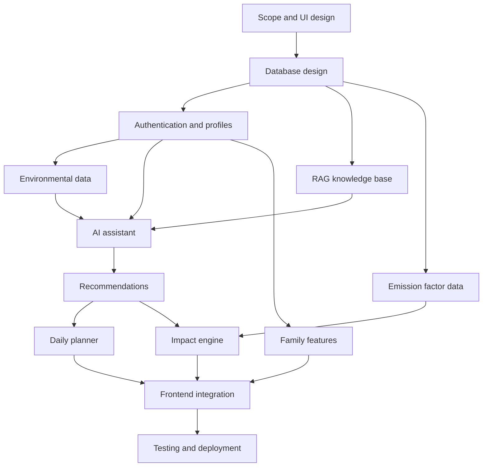

# AirWise AI — Development Phases

**Approach:** Build a working vertical slice in small phases.
**Frontend:** React + Bootstrap 5 responsive web application / PWA
**Backend:** Python + FastAPI using a project-local `.venv` virtual environment
**Database:** PostgreSQL + pgvector
**AI:** LLM + RAG

## 📋 Progress Tracking

| Phase | Name                                  | Status                | Commit                   |
| ----- | ------------------------------------- | --------------------- | ------------------------ |
| 0     | Scope and project setup               | ✅ **COMPLETE** | `657894b`, `2f24ecd` |
| 1     | Database design                       | ✅ **COMPLETE** | `4aadd9b`              |
| 2     | Authentication and user onboarding    | ✅ **COMPLETE** | `a1a64c7`, `7f77b70` |
| 3     | Environmental data integration        | ✅ **COMPLETE** | `8d5adb7`, `836ed55`, `dcbf5fc`, `0a98b27` |
| 4     | RAG knowledge base                    | ✅ **COMPLETE** | `0a98b27`                |
| 5     | LLM assistant                         | ✅ **COMPLETE** | (pending commit)         |
| 6     | Recommendation and daily planner      | ⏳ Pending            | —                       |
| 7     | Environmental impact engine           | ⏳ Pending            | —                       |
| 8     | Family functionality                  | ⏳ Pending            | —                       |
| 9     | Responsive frontend completion / PWA  | ⏳ Pending            | —                       |
| 10    | Testing, deployment and demonstration | ⏳ Pending            | —                       |

**Current Phase:** 5 — LLM assistant ✅ **COMPLETE** (pending commit & push)

## 1. Development strategy

Do not build every screen and every backend service independently and integrate everything at the end. Complete each phase with a working, testable result.

### Mandatory GitHub checkpoint after every phase

**Stop after completing every phase (Phase 0 through Phase 10). Do not begin the next phase automatically.**

At each phase boundary, the developer/AI coding agent must:

1. Run the relevant tests and checks for the completed phase.
2. Review the changed files and summarize what was implemented.
3. Confirm that no secrets, `.env` files, credentials, generated virtual environments, or other excluded files are staged.
4. Update relevant documentation and setup instructions.
5. Show the user the Git status and the exact suggested commit message.
6. Provide the Git commands needed to add, commit, and push the completed phase to GitHub.
7. **Stop and ask the user to commit and push the changes to GitHub.**
8. Wait for the user's explicit confirmation that the commit and push are complete before starting the next phase.

Do not silently commit or push on the user's behalf. Do not continue to the next phase while the GitHub checkpoint is pending. If the user reports a Git error, help resolve it and repeat the checkpoint. If the user explicitly asks to skip a checkpoint, confirm that instruction before proceeding.

Suggested checkpoint commands (adapt paths and branch name to the repository):

```bash
git status
git add .
git status
git commit -m "Complete Phase N: short description"
git push origin <branch-name>
```

For the initial Phase 0 repository setup, initialize Git, connect the user's GitHub repository, and make the first push only after the user has reviewed and approved the initial files. Never invent the GitHub remote URL or assume the branch name; ask the user when these are unknown.

### Backend Python virtual environment

Use Python's built-in `venv` for the backend. Create the environment inside the backend folder as `backend/.venv`:

```bash
cd backend
python -m venv .venv
```

Activate it:

**Windows PowerShell**

```powershell
.venv\\Scripts\\Activate.ps1
```

**Windows Command Prompt**

```bat
.venv\\Scripts\\activate.bat
```

**macOS / Linux**

```bash
source .venv/bin/activate
```

Install backend dependencies using `pip` inside the activated environment. Keep dependencies recorded in `requirements.txt` (or the project's agreed dependency file). Add `.venv/`, `.env`, `__pycache__/`, and other generated or secret files to `.gitignore`. Never commit the virtual environment itself or secret environment files.

This `venv` requirement is the current project instruction and takes precedence over any earlier documentation that mentions `uv` for backend environment management.

## 2. Phases

### Phase 0 — Scope and project setup

**Tasks**

- Confirm MVP requirements.
- Confirm technology versions.
- Create repository.
- Define coding conventions.
- Create environment setup instructions.
- Create wireframes and design tokens.

**Deliverables**

- Approved feature list.
- UI/UX reference.
- Initial project repository.
- Development setup guide.

**Acceptance criteria**

- Team agrees on what is included in MVP.
- Web app starts locally.
- Bootstrap theme and responsive shell are visible.

### Phase 1 — Database design

**Tasks**

- Finalize ER diagram.
- Define tables, keys and constraints.
- Decide location and pollutant units.
- Define family privacy rules.
- Define emission-factor provenance.
- Plan migrations and seed data.

**Deliverables**

- Database schema.
- ER diagram.
- Migration plan.
- Sample data.

**Acceptance criteria**

- User, profile and family relationships work.
- Environmental readings preserve provider and timestamps.
- Impact records retain calculation assumptions.

### Phase 2 — Authentication and user onboarding

**Tasks**

- Registration and login.
- Secure password hashing.
- Token/session handling.
- Profile creation and update.
- City/state selection.
- Lifestyle preference form.
- Optional family setup entry point.

**Deliverables**

- Working authentication.
- Onboarding screens.
- User profile APIs.

**Acceptance criteria**

- User can register, log in and log out.
- User can update location and preferences.
- Protected endpoints reject unauthenticated requests.

### Phase 3 — Environmental data integration

**Tasks**

- Select official Indian AQI data integration.
- Evaluate OpenAQ supplementary coverage.
- Integrate weather provider.
- Implement location search/geocoding.
- Normalize pollutant units.
- Add data freshness and quality flags.
- Implement cache and provider error handling.

**Deliverables**

- Environmental data service.
- Dashboard AQI and weather cards.
- Provider status and freshness labels.

**Acceptance criteria**

- Supported locations display sourced readings.
- Missing data is not represented as zero.
- Stale data is clearly identified.
- AQI standard is visible.

### Phase 4 — RAG knowledge base

**Tasks**

- Collect trusted environmental documents.
- Review source and publication dates.
- Extract PDF/web text.
- Preserve page and source metadata.
- Chunk documents.
- Generate embeddings.
- Store chunks and vectors in pgvector.
- Implement semantic retrieval.
- Test retrieval with a fixed question set.

**Deliverables**

- Initial knowledge base.
- Document ingestion process.
- Retrieval service.
- Source citation metadata.

**Acceptance criteria**

- Relevant questions retrieve relevant document passages.
- Source and page references can be returned.
- Untrusted or outdated documents can be disabled.
- No-result retrieval is handled safely.

### Phase 5 — LLM assistant

**Tasks**

- Connect chosen LLM provider.
- Create grounded system prompts.
- Combine user context, AQI context and RAG passages.
- Add conversation history.
- Validate structured responses.
- Add source references.
- Add prompt-injection safeguards.
- Add rate limits and cost monitoring.

**Deliverables**

- Working AI chat page.
- Backend assistant endpoint.
- Structured recommendation response.

**Acceptance criteria**

- Assistant answers with relevant evidence.
- It admits when data or evidence is missing.
- It does not invent live readings or impact values.
- API secrets remain server-side.

### Phase 6 — Recommendation and daily planner

**Tasks**

- Define recommendation categories.
- Implement safety-related deterministic rules.
- Generate personalized sustainable actions.
- Build daily planner calendar/agenda.
- Add event creation, editing, deletion and completion.
- Allow suitable recommendations to be added to the planner.

**Deliverables**

- Recommendation page.
- Daily Planner page.
- Add/Edit Event modal.

**Acceptance criteria**

- User can create and manage events.
- AI recommendations are relevant to user preferences.
- Events persist after refresh.
- Mobile planner uses a readable agenda layout.

### Phase 7 — Environmental impact engine

**Tasks**

- Select reliable emission-factor references.
- Define units and calculation boundaries.
- Implement transport calculations.
- Add activity logging.
- Store factor snapshots and method version.
- Build impact summaries and charts.

**Deliverables**

- Impact calculator.
- Impact Tracker page.
- Calculation detail view.

**Acceptance criteria**

- Calculations are reproducible.
- Assumptions and source are visible.
- Estimates are labelled as estimates.
- No unsupported PM2.5 or health benefit is claimed.

### Phase 8 — Family functionality

**Tasks**

- Create family groups.
- Generate invitations.
- Join/leave family.
- Define roles.
- Create shared goals.
- Share only opted-in actions and metrics.
- Implement backend authorization tests.

**Deliverables**

- Family dashboard.
- Invitation flow.
- Shared goals and progress.

**Acceptance criteria**

- Unauthorized users cannot access family information.
- Private chat history stays private.
- Family progress uses only permitted shared records.

### Phase 9 — Responsive frontend completion / PWA

**Tasks**

- Complete dashboard.
- Complete AI Assistant.
- Complete Recommendations.
- Complete Impact Tracker.
- Complete Profile/Settings.
- Test Bootstrap layouts on mobile, tablet and desktop.
- Add PWA manifest and service worker if required.
- Add accessible loading, empty and error states.

**Deliverables**

- Responsive web application.
- Optional installable PWA.

**Acceptance criteria**

- Core journeys work on narrow mobile screens.
- Navigation is usable with touch and keyboard.
- Offline mode never presents stale AQI as live.

### Phase 10 — Testing, deployment and demonstration

**Tasks**

- Unit tests.
- API integration tests.
- Database tests.
- RAG retrieval evaluation.
- AI factuality and citation evaluation.
- Responsive UI testing.
- Security checks.
- Deployment.
- Demo data and presentation preparation.

**Deliverables**

- Deployed MVP.
- Test report.
- Demo script.
- Known limitations list.

**Acceptance criteria**

- Main user journey works end-to-end.
- Provider failures are handled gracefully.
- No critical access-control issues remain.
- Demo clearly distinguishes estimates from measurements.

## 3. Mandatory phase completion and GitHub push gates

Apply this gate at the end of **every** phase, including Phase 0 and Phase 10. The phase is not considered closed until the user confirms that the changes have been committed and pushed.

| Gate        | Required action                                                                                                       |
| ----------- | --------------------------------------------------------------------------------------------------------------------- |
| 1. Verify   | Run phase-specific tests, linting/type checks where configured, and a basic manual smoke test.                        |
| 2. Review   | Summarize completed work, changed files, test results, and known issues.                                              |
| 3. Protect  | Check `git status`; ensure `.env`, `backend/.venv/`, credentials, API keys, and generated files are not staged. |
| 4. Prepare  | Suggest a clear phase-specific commit message and show the exact Git commands.                                        |
| 5. Ask      | Ask the user to commit and push the phase to their GitHub repository.                                                 |
| 6. Pause    | Stop all implementation work and wait for explicit confirmation of a successful push.                                 |
| 7. Continue | Only after confirmation, start the next phase.                                                                        |

Suggested commit messages:

- Phase 0: `chore: initialize AirWise AI project`
- Phase 1: `feat(database): complete database design and setup`
- Phase 2: `feat(auth): complete authentication and onboarding`
- Phase 3: `feat(environment): integrate air quality and weather data`
- Phase 4: `feat(rag): build environmental knowledge base`
- Phase 5: `feat(ai): implement grounded AI assistant`
- Phase 6: `feat(planner): add recommendations and daily planner`
- Phase 7: `feat(impact): implement environmental impact tracking`
- Phase 8: `feat(family): add family groups and shared goals`
- Phase 9: `feat(frontend): complete responsive application`
- Phase 10: `test(deploy): complete testing and deployment`

The user may choose a different commit message. Never claim a commit or push succeeded unless the user or an authorized Git tool confirms it.

## 4. Recommended MVP cut line

### Must have

1. Registration/login.
2. User profile and city selection.
3. AQI and weather dashboard.
4. RAG-based AI assistant.
5. Personalized sustainable recommendations.
6. Daily planner with add/edit/complete event.
7. Basic transport emission calculator.
8. Impact summary.

### Should have

1. Family group creation and invitations.
2. Shared family goals.
3. Historical AQI chart.
4. Source document administration.
5. PWA installation.

### Could have

1. Community challenges.
2. Advanced notification rules.
3. Multilingual assistant.
4. Route comparison.
5. Downloadable impact reports.

## 5. Dependency order



## 6. Suggested work breakdown for a short hackathon

If time is limited, use this sequence rather than attempting every phase:

| Sprint   | Focus                           | Demonstrable result                         |
| -------- | ------------------------------- | ------------------------------------------- |
| Sprint 1 | Setup, database, authentication | User can register and save profile          |
| Sprint 2 | AQI integration and dashboard   | User sees sourced local air-quality data    |
| Sprint 3 | RAG and AI                      | User receives grounded recommendations      |
| Sprint 4 | Planner and impact calculator   | User records an action and sees an estimate |
| Sprint 5 | Responsive polish and demo      | End-to-end mobile-friendly web MVP          |

## 7. Definition of done for every phase

A phase is complete only when:

- Code is integrated into the main branch.
- Basic tests pass.
- Errors and empty states are handled.
- API documentation is updated.
- No secrets are committed.
- UI works on mobile and desktop where relevant.
- Known limitations are documented.

## 8. Required phase handoff message

At the end of each phase, present a short handoff containing:

- Phase number and name.
- Features/files completed.
- Tests/checks executed and their results.
- Any known limitations or unfinished items.
- Git status and files that should be committed.
- Suggested commit message.
- Exact commands to commit and push.

Then ask: **“Phase N is complete. Please commit and push these changes to GitHub. Have you successfully pushed them? I will wait for your confirmation before starting Phase N+1.”**

Do not start the next phase until the user confirms.
